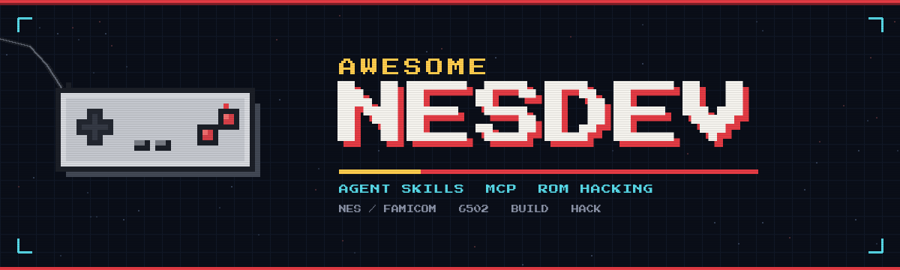

<p align="center">
  
</p>

# AWESOME NESDEV

**Agent skills, MCP servers, and field notes for NES / Famicom homebrew and ROM hacking.**

Not a link dump. Every entry says what it is for, how to install it, and where it breaks.
Last verified **October 2026**.

[Start here](docs/start-here.md) · [The agent stack](docs/agent-stack.md) · [MCP servers](docs/mcp-servers.md) · [Agent skills](docs/agent-skills.md) · [Skills library](skills/) · [Tecmo Super Bowl](skills/tecmosuper/README.md) · [Homebrew](docs/homebrew.md) · [ROM hacking](docs/romhacking.md) · [Cold-ROM playbook](docs/cold-rom-playbook.md) · [Reference](docs/reference.md) · [Troubleshooting](docs/troubleshooting.md) · [Resources](docs/resources.md) · [Glossary](docs/glossary.md) · [Sources](docs/sources.md)

---

## The 60-second version

There is one all-in-one option, two strong emulator-MCP families, and a handful of skill packs. Start with **romdev**; add **MesenCE** when you need a debugger and a procedure for a cold ROM.

```bash
# Node 24+ — builds, runs, inspects and patches 19 retro systems
npx romdevtools

# Save the agent skill it generates
mkdir -p ~/.claude/skills/romdev
curl -s http://127.0.0.1:7331/skills/romdev/SKILL.md > ~/.claude/skills/romdev/SKILL.md

# Register the MCP (Claude Code syntax; any streamable-HTTP client works)
claude mcp add --transport http romdev http://127.0.0.1:7331/mcp
```

Then ask your agent for the thing you actually want:

```text
Fork the nes/platformer example into ./mygame, build it, run 240 frames,
and show me the screenshot. Then change the player color and rebuild.
```

That fork → build → run loop is the single biggest quality-of-life change in NES agent work. It takes about 30 seconds and needs no host compiler.

### Pick your stack

| If you want to… | Use | Page |
|---|---|---|
| Build a homebrew game with the least setup | **romdev** + its generated skill | [Homebrew](docs/homebrew.md) |
| Debug frame-by-frame with NES workflows | **MesenCE** + `mesence` plugin, or **Mesen MCP** / **mcp-bizhawk** | [MCP servers](docs/mcp-servers.md) |
| Reverse-engineer or hack a commercial ROM | **nes-skills** (FCEUX Lua + retrodisasm) + **romdev** | [ROM hacking](docs/romhacking.md) |
| Start from a completely undocumented ROM | **cold-ROM playbook** + MesenCE/romdev | [Cold-ROM playbook](docs/cold-rom-playbook.md) |
| Run a multi-day RE campaign | **re-skill** + **romdev** + **GhidraMCP** | [Agent skills](docs/agent-skills.md) |
| Learn the platform properly | [Reference](docs/reference.md) + [Resources](docs/resources.md) | — |

---

## What this wiki covers

| Page | What is in it |
|---|---|
| [Start here](docs/start-here.md) | Prerequisites, install order, your first 30 minutes, OS notes, legal basics |
| [The agent stack](docs/agent-stack.md) | How MCP servers and skills fit together; copy-paste configs for Claude Code, Codex, opencode |
| [MCP servers](docs/mcp-servers.md) | Every server reviewed: capabilities, install, config, example calls, caveats |
| [Agent skills](docs/agent-skills.md) | Every skill pack, install commands, what it is good for, how to write your own |
| [Homebrew](docs/homebrew.md) | Toolchains, project layout, PPU bring-up, sound, mappers, testing |
| [ROM hacking](docs/romhacking.md) | Triage → dynamic analysis → static analysis → patch → verify, with a worked example |
| [Cold-ROM playbook](docs/cold-rom-playbook.md) | The same loop for a ROM with no docs: header, value search, CDL sessions, banked-address discipline |
| [Reference](docs/reference.md) | CPU memory map, PPU registers, iNES header, mappers, 6502 quick reference |
| [Troubleshooting](docs/troubleshooting.md) | The error messages you will actually hit, and the fix |
| [Resources](docs/resources.md) | Non-agent NESdev links: docs, emulators, graphics, audio, hardware |
| [Glossary](docs/glossary.md) | PRG, CHR, mapper, OAM, CDL, NMI, and the rest |
| [Sources](docs/sources.md) | Where every claim came from, with dates and versions |
| [Tools](tools/README.md) | Header parser, bank-aware address math, CDL merge/stats |
| [Skills library](skills/README.md) | NESdev hardware skills plus a Tecmo Super Bowl category |
| [TSB documentation library](docs/tsb/README.md) | 174 index cards from the TSB Hacks documentation directory |

---

## Installable skills

Seven NESdev hardware skills plus an eight-skill Tecmo Super Bowl category, each with references and failure-mode checklists:

| Skill | Covers |
|---|---|
| [nesdev-wiki-guide](skills/nesdev-wiki-guide/SKILL.md) | Routing a question to the right page |
| [nes-memory-map](skills/nes-memory-map/SKILL.md) | CPU/PPU address spaces, mirrors, vectors, warmup |
| [nes-ppu-rendering](skills/nes-ppu-rendering/SKILL.md) | Rendering, palettes, sprites, scrolling, NMI |
| [nes-cart-mappers](skills/nes-cart-mappers/SKILL.md) | iNES/NES 2.0, NROM/UxROM/MMC1/MMC3, banking |
| [nes-apu-audio](skills/nes-apu-audio/SKILL.md) | Channels, frame counter, envelopes, DMC |
| [nes-input-devices](skills/nes-input-devices/SKILL.md) | Controller reads, DPCM glitch, Zapper, Four Score |
| [nes-6502-assembly](skills/nes-6502-assembly/SKILL.md) | Addressing modes, cycles, jump tables, optimization |
| [tecmosuper-events](skills/tecmosuper-events/SKILL.md) | TSB cutscenes: bank/scene IDs, calls, full event library |
| [tecmosuper-rom-map](skills/tecmosuper-rom-map/SKILL.md) | TSB banks, file offsets, data locations |
| [tecmosuper-hacking](skills/tecmosuper-hacking/SKILL.md) | TSBTool SET commands, hex edits, rebuild, patches |
| [tecmosuper-graphics](skills/tecmosuper-graphics/SKILL.md) | Uniforms, helmets, portraits, logos, palettes, screens |
| [tecmosuper-gameplay](skills/tecmosuper-gameplay/SKILL.md) | Kicking, clock, downs, injuries, fumbles, conditions |
| [tecmosuper-playbooks](skills/tecmosuper-playbooks/SKILL.md) | Play scripts, slots, names, defensive reactions |
| [tecmosuper-sim](skills/tecmosuper-sim/SKILL.md) | COM juice, sim weights, coverage, season sim |
| [tecmosuper-data](skills/tecmosuper-data/SKILL.md) | Rosters, attributes, team pointers, schedule, saves |

```bash
cp -r skills/nes*/ skills/tecmosuper-*/ ~/.claude/skills/
```

Details and provenance: [skills/README.md](skills/README.md).

---

## What "agent-ready" actually means here

An MCP server gives the model **hands** — read memory, step a frame, assemble a ROM.
A skill gives it a **procedure** — which order to do things in, which footguns to avoid.
Neither replaces knowing the platform. The NES is a 1983 console with a PPU that will happily show you a black screen for a dozen reasons; the wiki pages concentrate on those failure modes.

**Three rules that save hours:**

1. **One emulator session per agent.** romdev isolates sessions with an `x-romdev-session` header; Mesen and BizHawk do not. Two agents on one emulator will fight over breakpoints and memory writes.
2. **Pin versions.** These are mostly one-person projects. Record the version in your project README; re-read a skill's `SKILL.md` after upgrading.
3. **Verify in the emulator, not in the chat.** A model can be confident and wrong about PPU timing. Use screenshots, memory reads and frame checks as the source of truth.

---

## Status board

| Component | Version at time of writing | State |
|---|---|---|
| romdev | `0.150.2` (Oct 16, 2026) | ✅ verified end-to-end on NES |
| Mesen MCP fork | `mesen-mcp-v0.2` (May 4, 2026) | ✅ usable; Windows x64 prebuilt only |
| MesenCE + `mesence` | plugin `3.1.1`, 57 tools (Sep 2026) | 🧪 0★; closest to an NES end-to-end kit |
| mcp-bizhawk | npm `0.1.x` (Oct 2026) | ✅ usable; ~1 frame latency |
| mcp-nes | repo, Feb 2026 | ⚠️ gameplay only; no memory access |
| Nes.Mcp | NuGet `0.0.11` (Oct 2026) | 🧪 early; 4 mappers, no PPU/OAM |
| GhidraMCP | Ghidra 12.1.4 | ✅ general RE; no iNES loader |
| nes-skills | repo, Jun 2026 | ✅ content; ⚠️ 1★, no license file |
| re-skill | repo, Mar 2026 | ✅ process; 174★, MIT |
| dotnes skills | repo, Sep 2026 | ✅ reference; tied to dotnes repo |
| sadnescity/romhacking | plugin `1.0.1` (Sep 2026) | ✅ MIT; translation method, not mechanics |
| gearlynx-romhacking | inside Gearlynx, Oct 2026 | ✅ genre template; Lynx, not NES |
| Tecmo Super Bowl skills | 8 skills + 174 doc cards, Oct 2026 | ✅ events, ROM map, hacking, graphics, gameplay, playbooks, sim, data |

Legend: ✅ works as described · ⚠️ read before trusting · 🧪 early / incomplete · ❌ not for NES

---

## Contributing

Corrections and new entries are welcome. Read [CONTRIBUTING.md](CONTRIBUTING.md) first — the bar is "I ran this and here is what happened", not "I saw a tweet".

## License

Text and configuration snippets are released under **CC0 1.0** — copy, remix, republish, no attribution required. Linked projects keep their own licenses; check before redistributing binaries or ROMs.

## Legal

This wiki contains no ROMs, no patches, and no copyrighted game data. Use dumps you own. Distributing ROMs or patched ROMs of commercial games is illegal in most jurisdictions. Homebrew you write is yours.
